# Highly innovative bearing life prediction! Predictive model based on multi-scale MSCNN-Informer +MATT

\n        \n  
\tPreface
The rolling bearings, as key components in mechanical equipment, have a significant impact on the accurate prediction of their remaining useful life (RUL). Traditional methods struggle to effectively handle the complex nonlinear dynamic characteristics and long-sequence dependency issues of bearing vibration signals, limiting prediction accuracy. This issue is addressed by introducing a novel dual-branch hybrid prediction model—MSCNN-Informer+MATT. This model integrates multi-scale convolutional neural networks (MSCNN) with the Informer model, utilizing a multi-head attention mechanism (MATT) for feature fusion. The specific implementation includes: MSCNN automatically extracting multi-scale spatial local features from bearing signals, Informer efficiently capturing long-sequence temporal dependencies, and MATT further integrating deep features from both branches to enhance the model's expressive power. The input features are selected based on 13 physical indicators, including kurtosis, entropy, fractal dimension, waveform metrics, spectral metrics, and statistical features, comprehensively reflecting the working state of the bearing. Experiments were conducted on a typical bearing dataset in the intelligent manufacturing field, using the model to perform interpretative analysis of feature importance, verifying the contributions of each indicator to lifespan prediction. The results show that the proposed model not only improves RUL prediction accuracy but also exhibits good generalization capability and model interpretability, effectively aiding in equipment condition monitoring and maintenance decision-making, possessing strong engineering application value.
1. Introduction to the innovative model
\t1.1 Model Evaluation:
\n        \n  
1.2 Predictive Visualization:
\n        \n  
\t1.3 Model Feature Analysis—Visualization:
\n        \n  
We also provide detailed materials, instructional documents, and video tutorials, including how to replace your own dataset, parameter tuning tutorials, etc. The code is commented line by line, with detailed introductions of parameters:
\n        \n  
● Dataset: XJTU-SY Rolling Bear Acceleration Life Test Dataset
● Environment Framework: Python 3.9, PyTorch 2.1 and above can be run.
● Usage Object: Paper requirements, graduation design requirements.
● Code Guarantee: The code comments are detailed and ready to run.
2. Introduction to Model Innovation Points
\n        \n  
\tOverall process and innovation description:
Innovation 1: Data Preprocessing and Feature Extraction
Firstly, raw time-series data from the rolling bearing vibration signal is collected, and preprocessing is conducted in conjunction with operational conditions of the bearing, including noise reduction and normalization. Subsequently, based on the physical mechanism of the bearing and signal characteristics, 13 key physical indicators are extracted as model input features. These include kurtosis, entropy, fractal dimension, waveform metrics, spectral metrics, frequency domain statistical features, and vibrational characteristics. These indicators reflect multiple aspects of the bearing's condition, providing a comprehensive representation for fault diagnosis in the model.
Innovation II: Parallel Network for Dual-Branch Feature Extraction
(1) Branch Design of Multi-Scale Convolutional Neural Network (MSCNN)
Multi-Scale Convolutional Neural Networks (MSCNN) are a class of deep learning architectures that build upon Convolutional Neural Networks (CNN) by employing multiple convolution kernel sizes to extract features concurrently. The core idea behind MSCNN is to leverage the convolutional kernels at different scales to capture multi-level, multi-granularity information from the input data, thereby enhancing the model's expressiveness and generalization capabilities.
\n        \n  
\tDesign MSCNN branch for multi-scale features in bearing vibration signals. Construct multi-scale feature extraction layers through the use of different sizes of convolutional kernels, automatically capturing multi-level feature representations in local spatial context. This branch focuses on mining the spatial structure information and local change features hidden in signals, providing rich spatial representation capabilities for the model.
(2) Informer Long-Sequence Time Series Modeling Branch Design
The Informer module is the core component of the model, and it has been optimized based on the Transformer structure. The main improvements include:
Sparse Self-Attention Mechanism: This reduces the complexity of self-attention computations in traditional Transformers from \(O(\text{L} \times 2)\) to \(O(\text{L} \log{\text{L}})\), enabling models to process time series with thousands of steps without compromising performance.
ProbSparse: Only retains the most important Query, significantly filters out unnecessary computational interference, and utilizes information entropy to select key areas.
Multi-layer encoder structure: stack multiple layers of encoder units, adding residual connections and layer normalization between them to stabilize training and enhance the hierarchy of feature representations.
Multi-head attention and feedforward network: Utilizing multi-head mechanisms in conjunction with position encoding to ensure the capture of temporal position information and different subspace features.
Decoder Structure Design: The decoder is designed based on the prediction step length, supporting multi-step load forecasting, and outputs are flexibly coordinated with the input sequence length.
\t  
\n        \n  
The life prediction of rolling bearings involves long-term sequential dependency modeling. The Informer model, based on the ProbSparse self-attention mechanism, significantly reduces the computational complexity of long sequences and effectively captures the long-term dependencies and dynamic evolution trends of vibration signals. This branch focuses on extracting information from time series to assist in accurate predictions of the life cycle.
Innovation 3: Multi-Head Attention for feature fusion
The multi-head attention mechanism is used to integrate features from different branches. Each attention head can be considered as a feature extractor, focusing on different parts or aspects of the features. The multi-head attention mechanism dynamically adjusts the importance of features by calculating the correlation weights between features, thereby achieving weighted integration of features. This mechanism not only enhances the expressive power of features but also strengthens the robustness of models by focusing on important features, combating noise and interference.
The extracted feature vectors from the MSCNN and Informer branches are introduced into the multi-head attention module. Originating from the Transformer mechanism, the multi-head attention allows for independent focus on different feature representations in multiple subspaces, and facilitates automatic learning of fused weights. This module promotes deep interaction and integration across branch features, enhancing the model's richness and robustness, and achieving more precise lifespan predictions.
Process 4: Predictive Output and Loss Function Design
The integrated deep features are mapped to the remaining life prediction values through fully connected layers. The model uses Mean Squared Error (MSE) as the loss function to optimize prediction errors, ensuring that the predicted values align with the actual life distribution.
(1) Model Training and Validation
On the typical bearing dataset in the field of intelligent manufacturing, model training is conducted on the training set, parameter tuning is performed on the validation set, and prediction performance is evaluated on the test set. The effectiveness of the multi-index comprehensive evaluation model is evaluated using R^2, RMSE, MAE, etc.
(2) Model Interpretation and Feature Importance Analysis
After training, the contribution of input features to life prediction is calculated using SHAP interpretability methods. The analysis results provide transparency for the model, assisting in understanding the role of various physical indicators in prediction, and enhance the credibility and practicality of the model.
3 Data Preprocessing and Visualization
\t3.1 Dataset Introduction
This experiment utilizes the XJTU-SY rolling bearing accelerated life test dataset. As shown in the figure, the platform consists of an AC motor, a motor speed controller, a shaft, support bearings, a hydraulic loading system, and test bearings. It is capable of conducting accelerated degradation experiments on bearings under different operating conditions and obtaining complete data from operation to failure. The radial force is generated by the hydraulic loading system and applied to the shell of the tested bearing. The rotational speed is set by the AC induction motor's speed controller and maintained constant. The sampling frequency is set at 25.6 kHz, recording 32,768 data points per minute (i.e., the sampling time for each minute is 1.28 seconds).
\t  
\n        \n  
A total of three types of operating conditions were designed, as shown in Table 2. Each type of condition included five bearings. The details of data division for the three operating conditions are as follows:
\t  
\n        \n  
3.2 Bearing1_1 data visualization
\n        \n  
The bearing dataset contains horizontal acceleration data and vertical acceleration data. Compared with the vertical acceleration data, the horizontal acceleration data can provide more effective degradation information. Therefore, experiments are conducted using the horizontal direction's acceleration data. The experiment will use bearing 1-1 and 1-2 under the condition of 35Hz12kN as the training set, and bearing 1-3 as the test set to conduct model experiments.
3.3 Dataset Preparation and Preprocessing
\n        \n  
Select
Kurtosis: Reflects the degree of signal peakiness.
Entropy: Represents the uncertainty of a signal.
Fractal Dimension: A measure of signal complexity
Waveform indicators (Crest Factor, etc.): Descriptive of the attributes of signal wave peaks
Spectral Metrics: Frequency-domain magnitude features extracted based on Fourier transform
\tFrequency domain indicators: Power spectral density, etc.
Statistical features: Mean, variance, skewness, etc.
Vibration characteristics: envelope in time domain
\tUsed time: The known usage time of the bearing.
13 indicators are used to capture multi-scale features of bearing signals, serving as the training and testing data for the remaining life prediction model. These features can capture the operating state of the bearing from multiple perspectives, ensuring a rich input for the model.
\t  
4. Prediction Model Based on MSCNN-Informer +MATT
4.1 Define the MSCNN-Informer +MATT prediction network model
\n        \n  
4.2 Set parameters and train the model
\n        \n  
4.3 Model Prediction and Evaluation
(1) Model Evaluation
\n        \n  
(2) Visualization of Prediction Results
\n        \n  
(3) Model Feature Analysis - Visualization
\n        \n  
This paper proposes a multi-index fusion input system that comprehensively covers the multi-scale features of bearing signals. The prediction effect based on MSCNN-Informer +MATT deep learning model is significant. The model can fully utilize the multi-scale and multi-frequency feature extraction capabilities of MSCNN, as well as supplementary time-series information, achieving fast convergence and superior performance. It achieves multi-scale and multi-level understanding of complex vibration signals in rolling bearings, significantly improving the accuracy of lifespan prediction.
\n        \n  
Previously Featured Content:
Rapid Document | Parallel Fault Diagnosis Model Based on 2D-SWinTransformer+1D-CNN-SENet
Significant update on bearing life prediction! New ensemble of CNN-BiGRU-Attention models + enriched visualization charts
Multimodal - Fault Diagnosis | The Big Core Convolution Opens a New Era in Vision!
Superior! Directly write in Zone 1! The fault diagnosis model based on SSA+Informer-SENet.
Multi-source information fusion: Data layer fusion + feature layer fusion for fault diagnosis models!
Gearbox fault diagnosis: Multimodal innovation model based on MTF+Swin-Informer.
Bearing signal fault diagnosis model based on multi-scale convolutional neural network (MSCNN-1D).
END

## Images

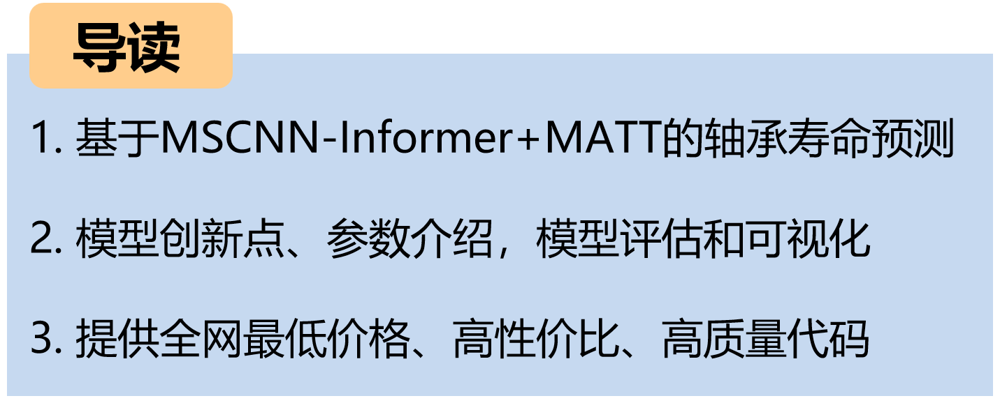
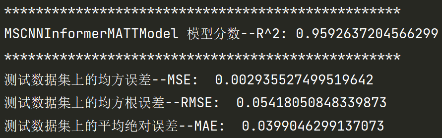

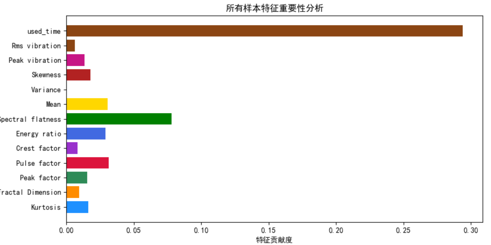

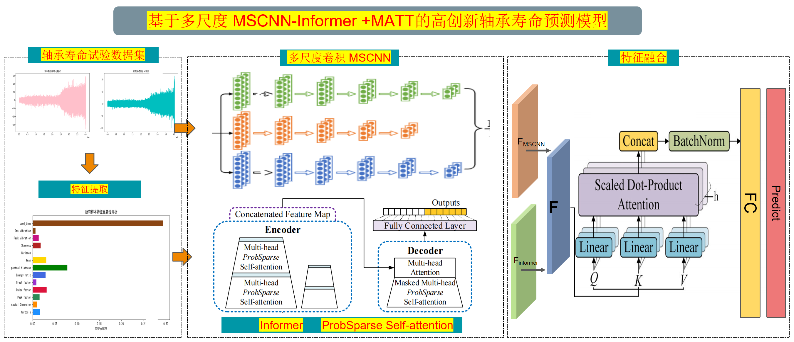
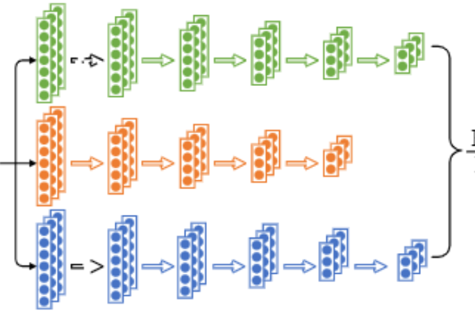
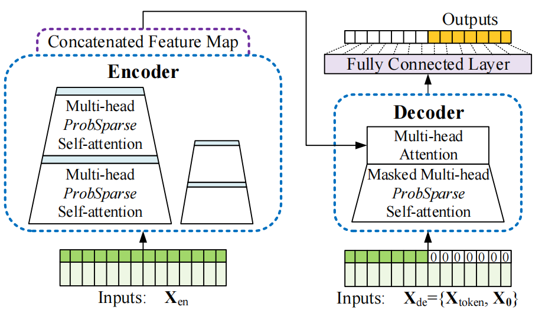
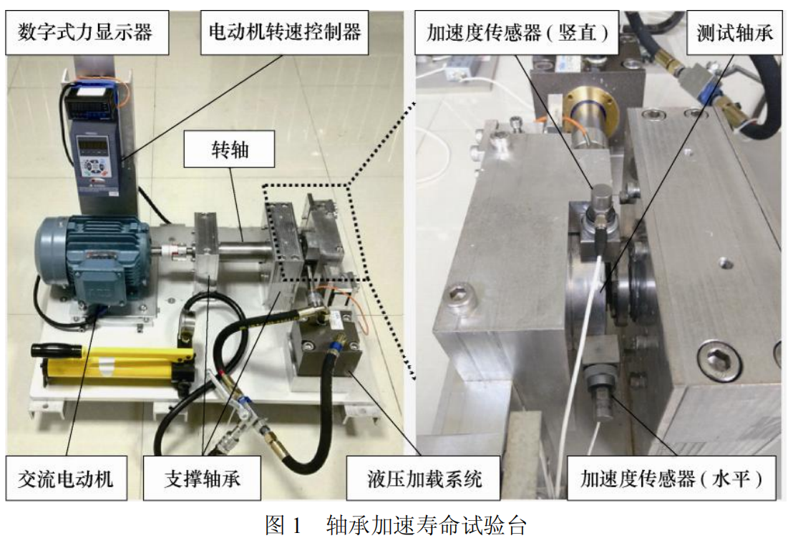
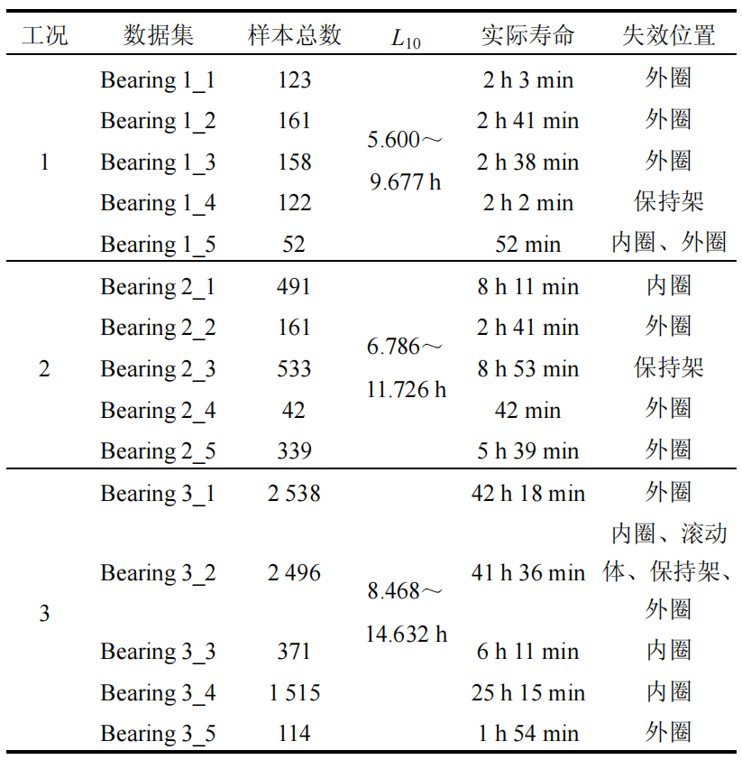
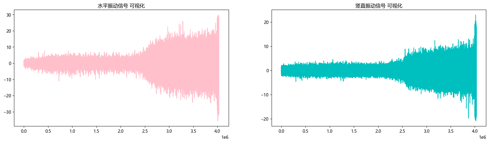
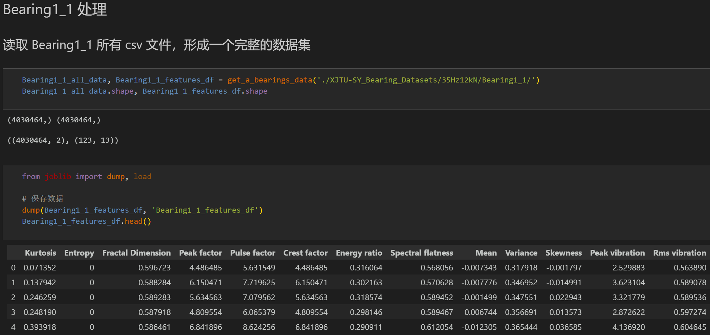
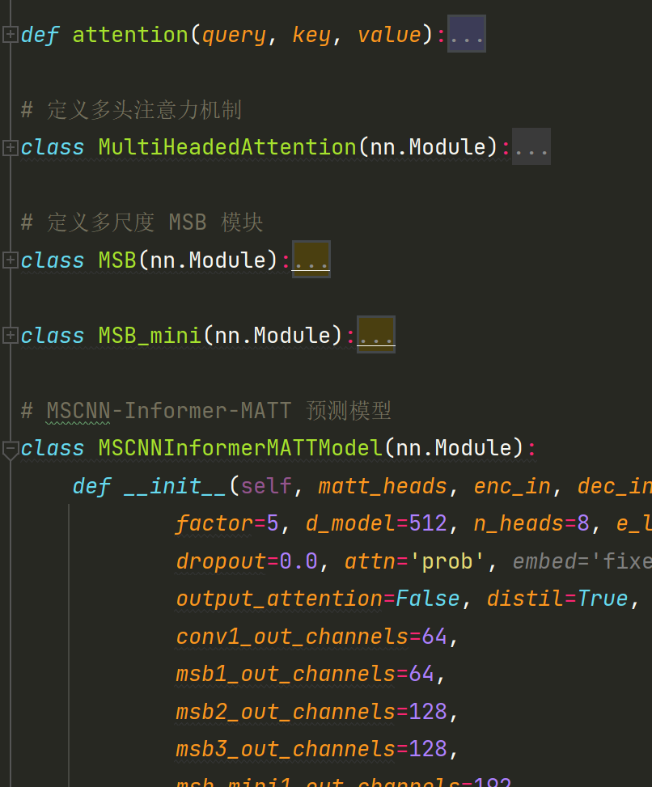
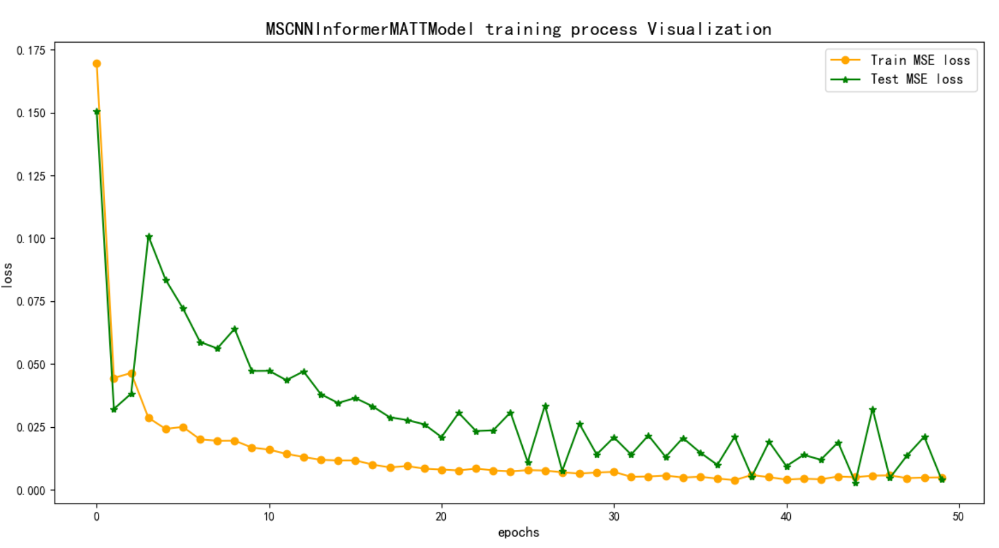

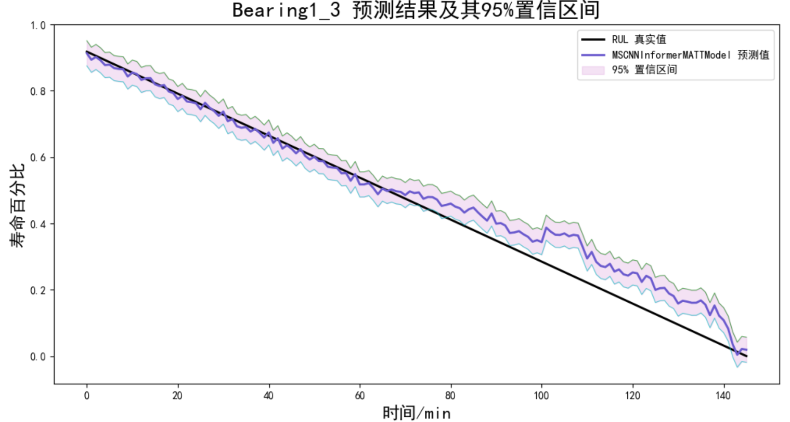

<!-- PAYMENT_BLOCK -->

## Get this dataset

- Payment link (Stripe): [Buy now](https://buy.stripe.com/3cs8yP7sY87d0vu9AB)
- Payment QR code: 

<!-- /PAYMENT_BLOCK -->
